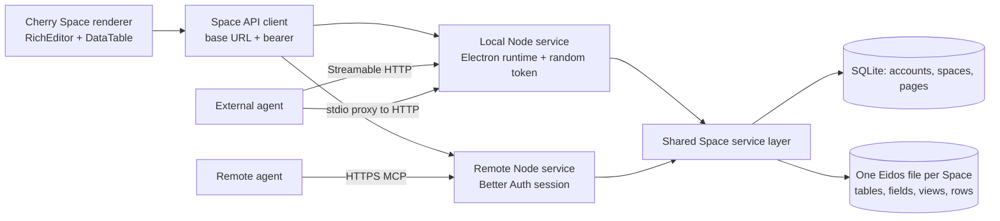

# npm Space architecture

The renderer has one Space page and one HTTP client. Local startup generates a bearer token, launches the server with the Electron executable and an ephemeral loopback port, then connects the existing built-in MCP record. Remote settings replace the URL and bearer token with a Better Auth session. Cherry's normal agent seeder binds the built-in MCP server on a new profile.

REST and MCP use `SpaceStore` for ownership checks, page operations and table operations. Each user has a current Space and can create more. A Space has its own `.eidos` file; page contents and account/Space metadata live in `spaces.sqlite`. User IDs are checked before resolving a Space or its data. The standard `@eidos.space/eidos-file` synchronous compatibility API owns Eidos writes and expected revisions; the application never writes its internal SQLite tables directly.

All writes are queued in one process. `server.lock` prevents another server from opening the same data directory; stdio is a proxy to that process, not a second database writer. The Eidos file revision applies to the whole file, so an unrelated row change may require a client to reread before retrying. Page revisions apply per page. Memory writes require Title, Body, Type and SourceAgent, check active memories with the same Type for similar normalized titles, and return `already-exists` or `stale-revision` rather than silently creating or overwriting.

Initialization creates a Memories table, an Agent Operating Guide page and a Skills directory if missing. It does not replace an edited guide or skill. Forget clears the current title, body and source URL and marks the row forgotten. It is not a secure erase of SQLite history, WAL files, backups or other copies. Page deletion is soft deletion.

Space data is separate from the old SiYuan workspace; no automatic migration is included. There is no cross-device sync engine, live collaboration, page-level ACL, or automatic merge of conflicting writes. A shared remote server is a single process and accounts can access only their own Spaces. See [deployment](deploy-server.md) and [verification](verification-npm-backend.md).
